

[&nbsp;Português](README.md) · [&nbsp;**English**](README.en.md)

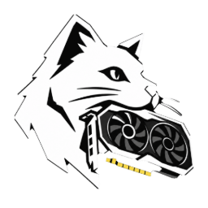

# IRON CHECK

### Hand back every device with a report, not a promise.

**Tests, diagnostics, drivers and PDF reports for computer repair shops. All in English and Portuguese (a switch with the Brazilian and US flags), in a program that runs from a USB stick.**

[⬇️ Download the full kit](https://github.com/MeoWDev-MOD/Iron-Check/releases/latest/download/Iron-Check-Kit.zip) ·
[💾 Program only](https://github.com/MeoWDev-MOD/Iron-Check/releases/latest/download/Iron-Check-Portatil.exe) ·
[🌐 Visit the website](https://meowdev-mod.github.io/Iron-Check/en/) ·
[💬 Ask for a trial key](https://wa.me/5521966547296?text=Hi!%20I%27d%20like%20a%20trial%20key%20for%20Iron%20Check.)

---

  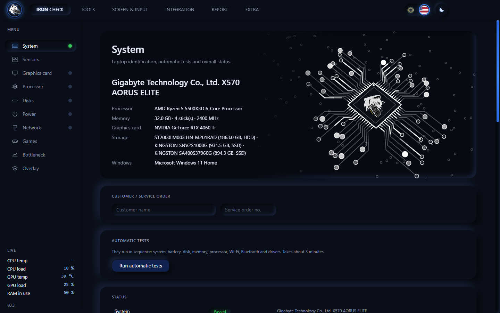

## 🐺 What it is

**Iron Check** is a Windows program made for **repair shop owners and computer service centers**. In one place, it **tests the whole computer**, **installs the missing driver (the network card one, even with no internet)**, prepares the machine, creates a bootable USB stick and **issues a PDF report with the service order** for you to hand to the customer and keep on file.

A device that comes back costs time, money and a customer. Iron Check was made so you stop handing things back on a promise: **fixed it? Now prove it.**

---

## 😩 Sound familiar?

- **Five programs for one repair.** One to read the hardware, another for the hard drive, another for memory, a website for the keyboard… each one works differently, and nothing gets recorded.
- **"You broke it."** With no proof of what was tested and how the device left your bench, it becomes your word against theirs.
- **Reinstalled Windows and lost the network.** Without the network card driver there is no internet to download the network card driver.
- **The fault that only shows up later.** A hard drive with bad sectors, failing video memory, a worn-out battery, a loose USB port.

| Today | With Iron Check |
|---|---|
| Several test programs and websites, each with its own way of working | **One program**, in English and Portuguese, that runs from a USB stick |
| Eyeballed tests and notes on paper or in a chat | Guided tests, with the **result of each one recorded** |
| The customer complains and you cannot prove it | **PDF report** with shop, service order, hardware and tests, with a unique code |
| Reinstalled Windows and the network card has no driver | Network driver on the USB stick, **installs without internet** (more than 400 card models) |
| You find the hard drive was failing after handing it back | **SMART, surface scan and performance** before delivery |
| You hand it back without knowing if it holds up under heavy use | **Stress test** with automatic cut-off by temperature |

---

## 🧰 What Iron Check does

**1 · Receive and identify**
- **Full hardware, CPU-Z style** — 13 categories (equipment, motherboard and BIOS, processor, memory, graphics, drives, display, network, audio, battery, devices, security and Windows).
- **Automatic tests** — system, battery, disk, memory, processor, Wi-Fi, Bluetooth and drivers in sequence.
- **Live sensors** — temperatures, loads, clocks, power draw and fans, with minimum, maximum and alerts.
- **Graphics card profile** and **battery health** (%, capacity and cycles).

**2 · Test each part**
- **Disks (HDD, SATA SSD and NVMe)** — SMART, read-only surface scan, performance and integrity.
- **RAM and processor** — errors counted, multi-core and single-core score, drop under heat.
- **Memory MeoW** — tests the video memory with 12 patterns, shows the failing bits and points to the likely cause.
- **Display, keyboard and touchpad** — dead pixels, stains, key by key, gesture by gesture.
- **USB ports, webcam, speakers, microphone, HDMI and charger** — plug in and see it instantly; clap and watch the microphone bar rise.
- **Wi-Fi and Bluetooth.**

**3 · Fix it and leave it ready**
- **Drivers, network first** — recognizes the network card and installs the driver from the library (Intel, Realtek, MediaTek, Qualcomm/Atheros and Broadcom), without internet.
- **NVIDIA video driver** — downloaded only from the official server, with the signature checked and a restore point first.
- **USB-serial converters and COM ports** (CH340, CP210x, FTDI, Prolific), **install apps**, **startup**, **optimize**.
- **Boot Creator** — writes an ISO to a UEFI USB stick. **Safe overclock** (NVIDIA), temporary and through the official route.

**4 · Prove it holds up**
- **Stress test** — processor, memory and graphics card together, with temperature cut-off and a chart of the last 5 minutes.
- **Benchmark** — 7 tests, with a score to compare before and after. **Network diagnostics.**

**5 · Deliver with proof**
- **PDF technical report** with shop, service order, customer, full hardware, the result of each test and signature lines. Comes out in English or Portuguese, following the language of the screen.
- **English and Portuguese** with one click, through the Brazilian and US flag switch at the top.
- **Unique code** on every report and an **authenticity check** (SHA-256): the *Verify* button shows whether the archived PDF was changed.

---

## 📄 The report

  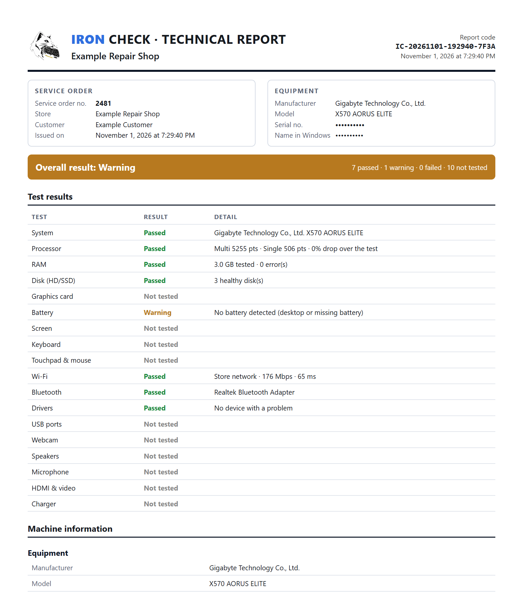 
  Sample report generated by the program. The device identifiers were hidden.

---

## 📸 Inside

| | |
|:---:|:---:|
| 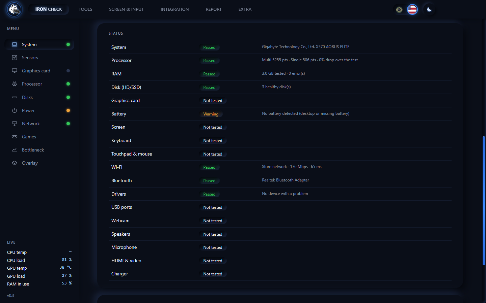 | 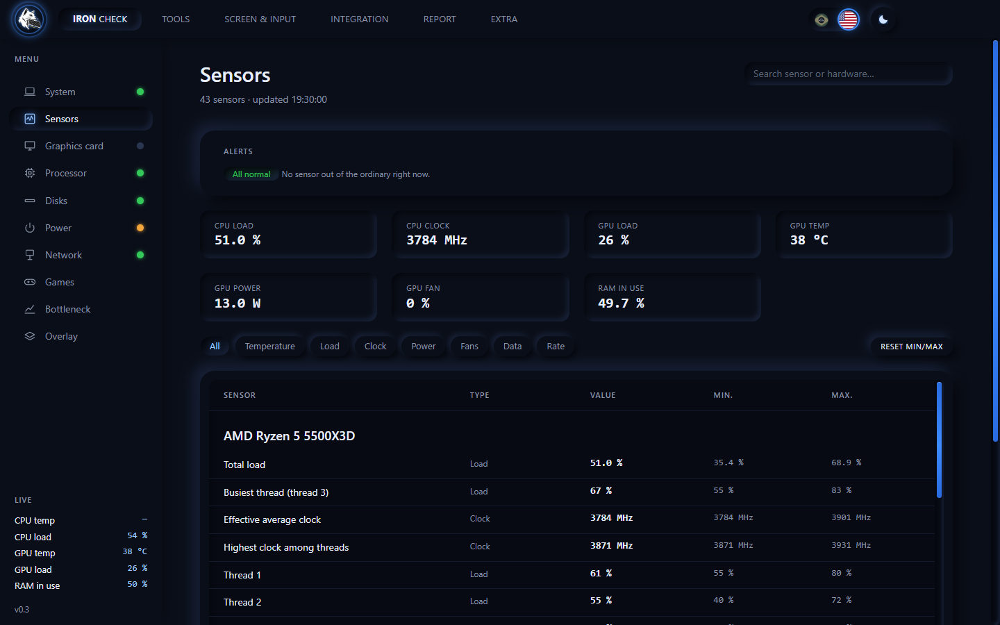 |
| **Automatic tests** — each test with its verdict | **Sensors** — live temperatures, loads and power draw |
| 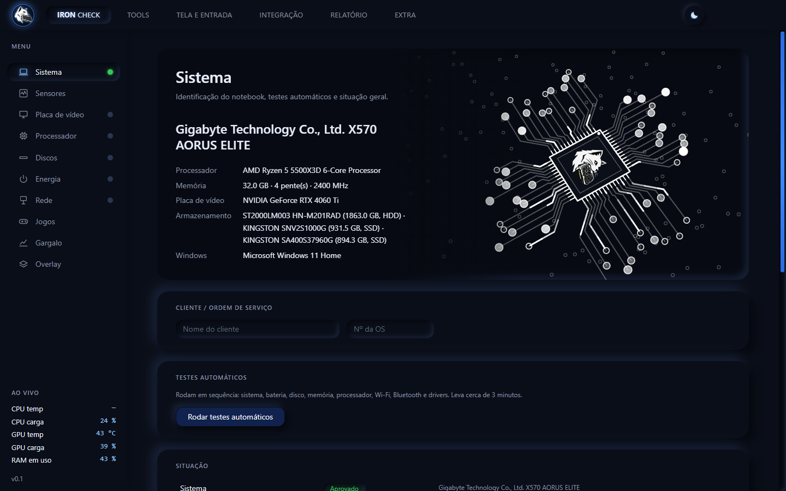 | |
| **English and Portuguese** — one click, report included (here, the same screen in Portuguese) | |
| 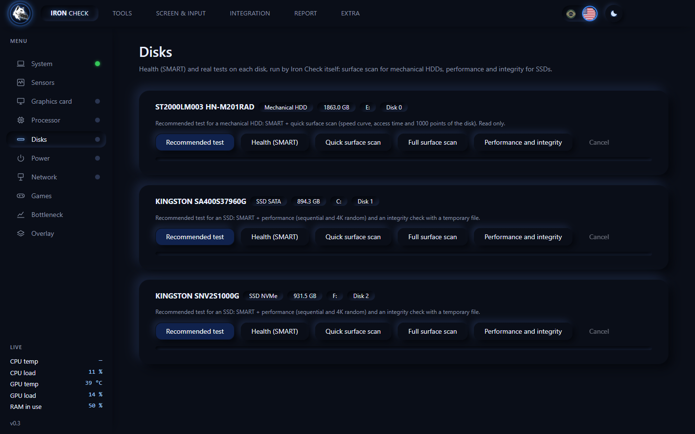 | 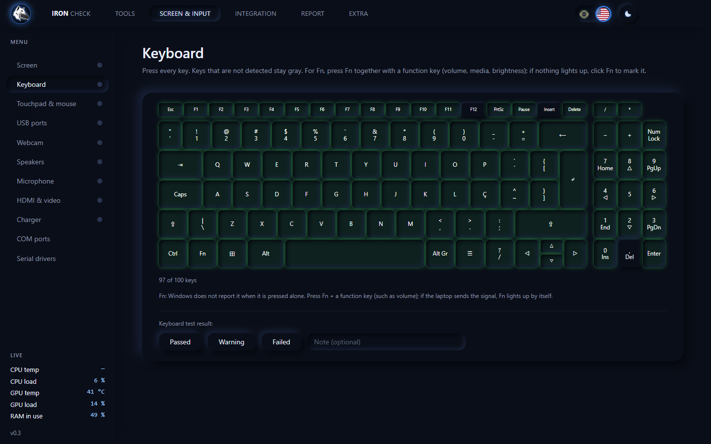 |
| **Disks** — SMART, surface, performance and integrity | **Keyboard** — each key lights up when pressed |
| 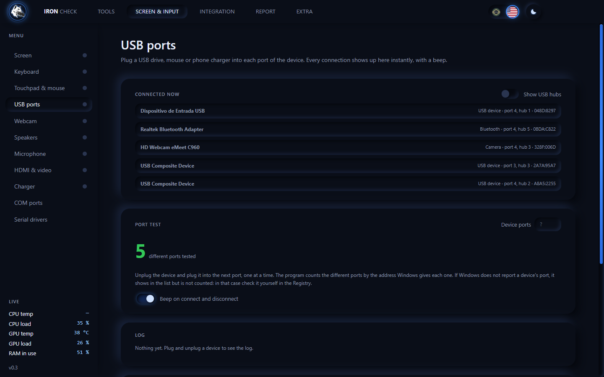 | 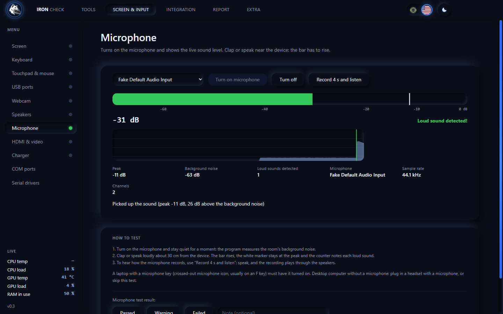 |
| **USB ports** — plug in and see it instantly | **Microphone** — clap and watch the bar rise |
| 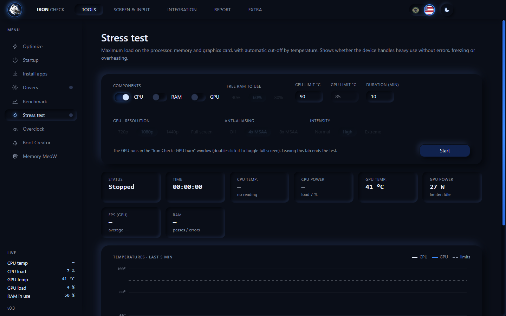 | 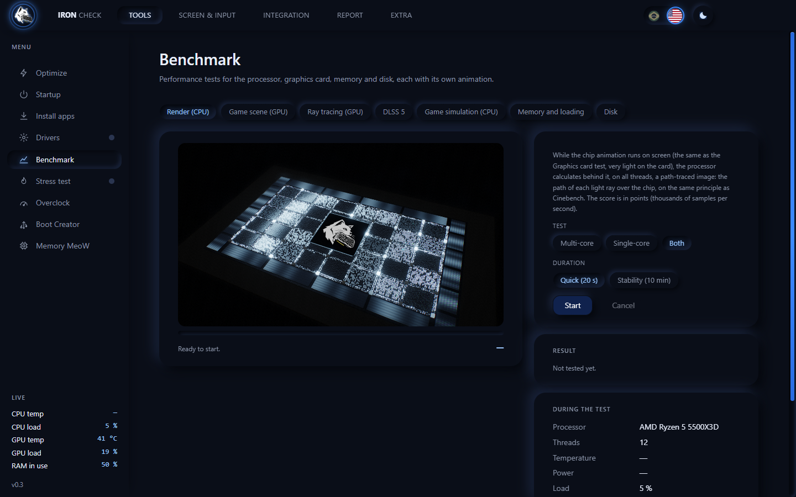 |
| **Stress test** — CPU, RAM and GPU with temperature cut-off | **Benchmark** — 7 tests with a score |
| 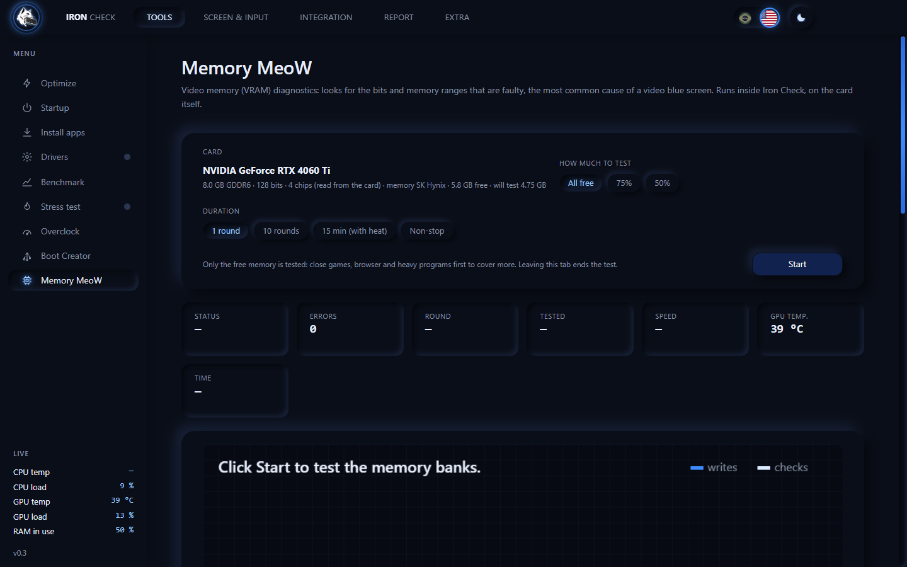 | 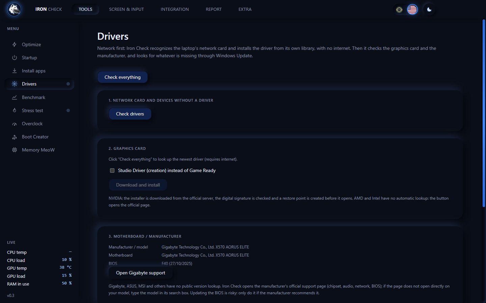 |
| **Memory MeoW** — looks for faults in the video memory | **Drivers** — network first, then video and the rest |
| 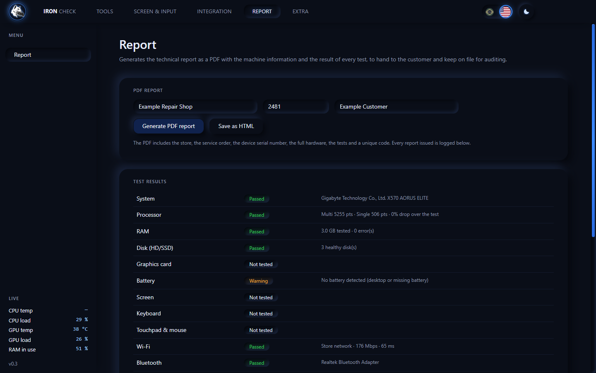 | 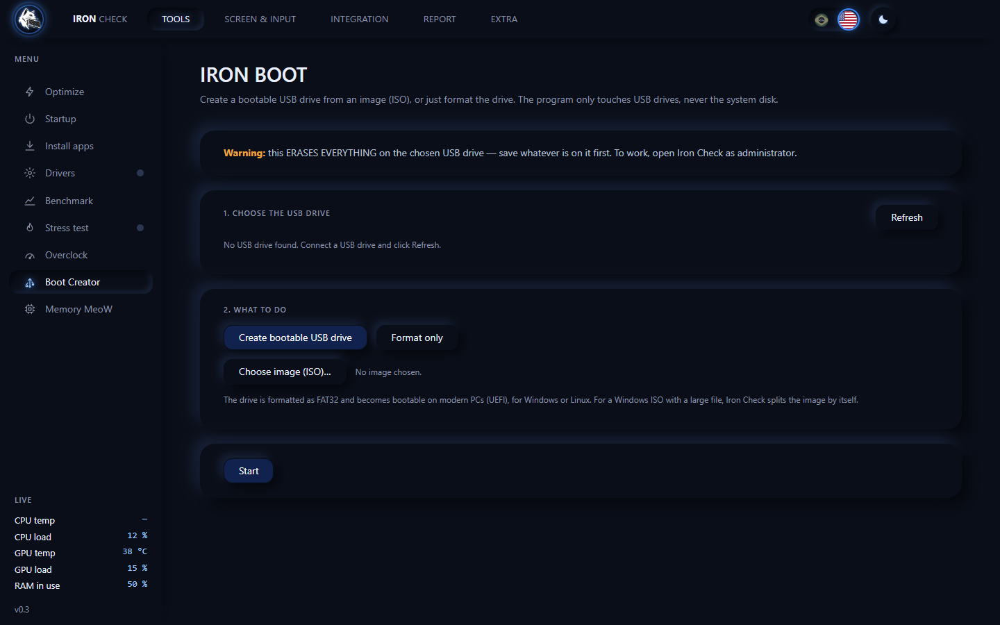 |
| **Report** — shop, service order and the PDF button | **Boot Creator** — bootable USB stick from a Windows or Linux ISO |

---

## ⬇️ Download

| File | What it is for |
|---|---|
| **[Iron-Check-Kit.zip](https://github.com/MeoWDev-MOD/Iron-Check/releases/latest/download/Iron-Check-Kit.zip)** (353 MB) | **Recommended.** The program + the `drivers` folder (more than 400 network card models and USB-serial converters) + README (in Portuguese). Extract it and take the whole folder to the USB stick. |
| **[Iron-Check-Portatil.exe](https://github.com/MeoWDev-MOD/Iron-Check/releases/latest/download/Iron-Check-Portatil.exe)** (92 MB) | Program only, to try it out. Opens by itself, but without the network driver library. |

**How to use it**
1. Ask for your key (trial or subscriber) on WhatsApp.
2. Extract the kit and open `Iron-Check-Portatil.exe`. Accept the Windows administrator prompt.
3. The **first launch prepares the files** in an `IronCheck-programa` folder next to the `.exe` (a few seconds); the next ones open fast (about 1 second in our test).
4. Type the key. The data (key and settings) stays in an `IronCheck-dados` folder **next to the file**, not on the customer's computer.
5. Keep the **`drivers` folder next to the `.exe`**: that is where the program installs the network card driver from, without internet.

> Windows may show the "unknown publisher" warning (SmartScreen): click **More info → Run anyway**. Some antivirus programs scan the file on first launch, which can take a few extra seconds.

---

## 🔑 Trial, subscription and support

- **Want to try it?** Ask for a **trial key** on WhatsApp: it lasts a few days and unlocks the full program.
- The **subscription is monthly**. Pay by **Pix** (Brazil's instant payment) and send the receipt on WhatsApp: you get your **key**, which works on **several computers** (made for technicians who service many PCs). For the price, just ask.
- The key is checked over the internet. Without confirmation, the program runs for up to 24 hours on the last check and then stays locked until it is sorted out. **Your files are never deleted.**
- **Computer with no network?** The activation screen offers the **Drivers** tab (only that one) to install the network card driver from the `drivers` folder. Once the network works, the key is checked by itself.
- Use of the same key by many people is detected, and the key can be blocked.

  <a href="https://wa.me/5521966547296?text=Hi!%20I%27d%20like%20a%20trial%20key%20for%20Iron%20Check."><b>📱 Chat on WhatsApp · +55 21 96654-7296</b></a>

---

## 🛡️ Safe for the customer's device

- The **surface scan only reads**; the performance test uses a temporary file deleted at the end. No test writes to the raw disk.
- **Boot Creator** only sees USB sticks and never touches the system disk.
- **Temporary overclock** (back to normal on reboot) and only through NVIDIA's official controls; the game tweaks keep the original value; the video driver gets a **restore point** before installing.
- Drivers only from **official sources**; the video one is downloaded from NVIDIA servers, with the digital signature checked.

---

## 💻 Requirements

- **Windows 10 or 11** (64-bit) on the computer where you open the file. Does not run on Windows 7 or 8.
- For the full tests (disk health, temperature, overclock, creating a USB stick): **run as administrator** (the program already asks).
- **NVIDIA GeForce** graphics card for the card-specific features (overclock, driver installation); AMD and Intel work for everything else.
- **Internet** to check the key (on launch and from time to time).

---

Developed By **MeoWDev MOD** · [@honorio.dev](https://www.instagram.com/honorio.dev/)

