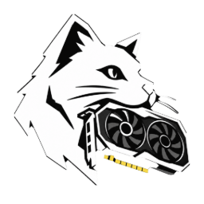
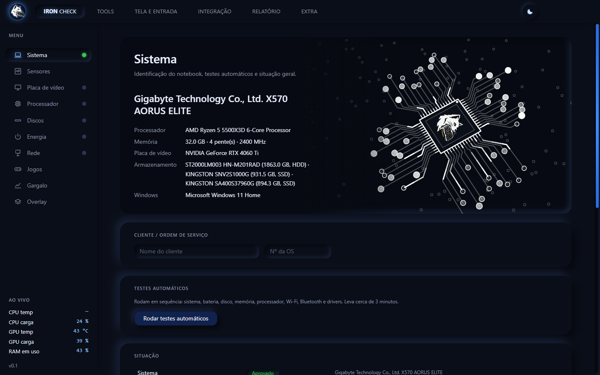
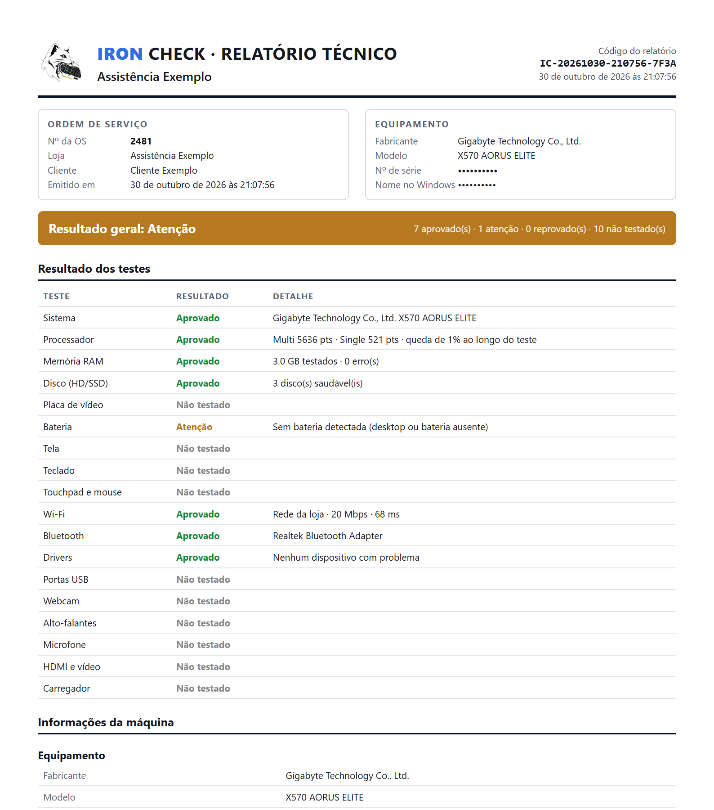
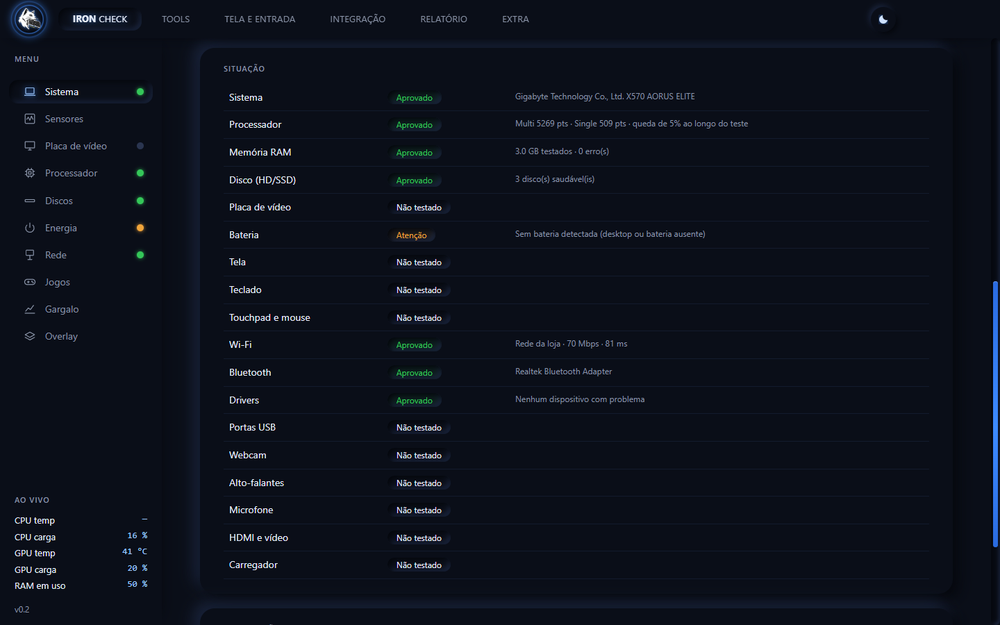
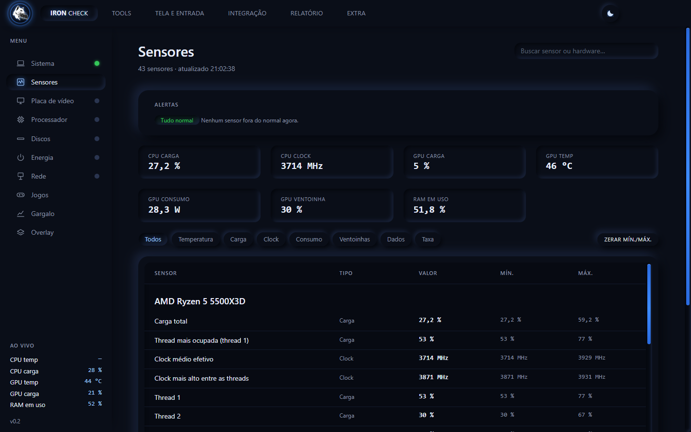
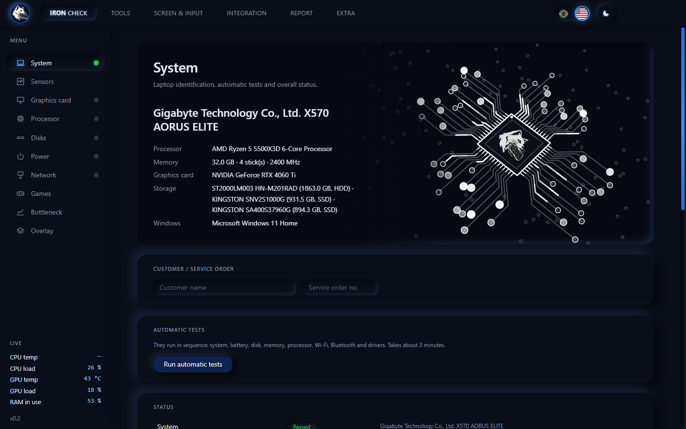
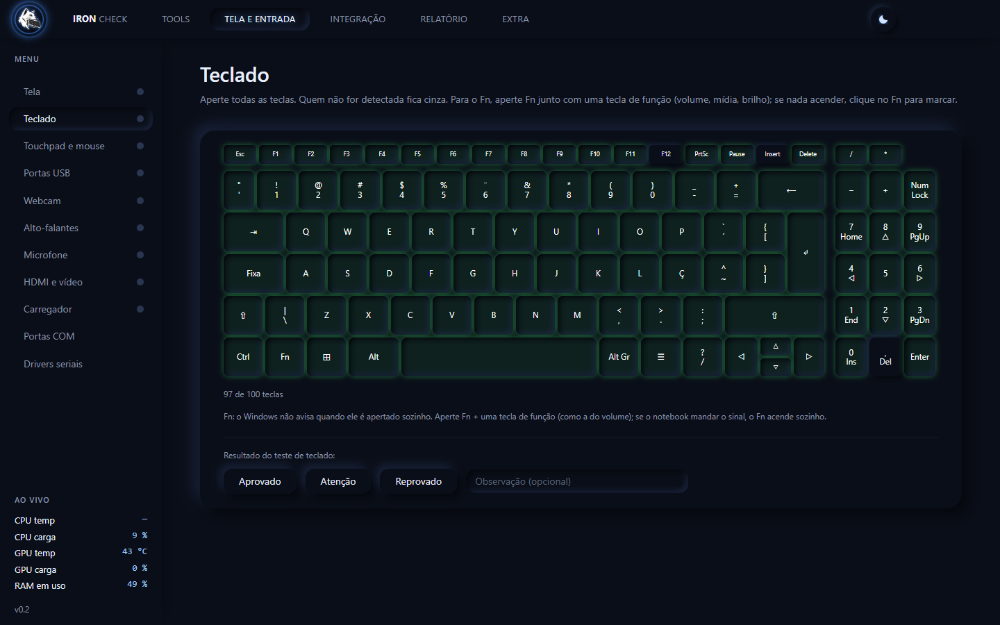
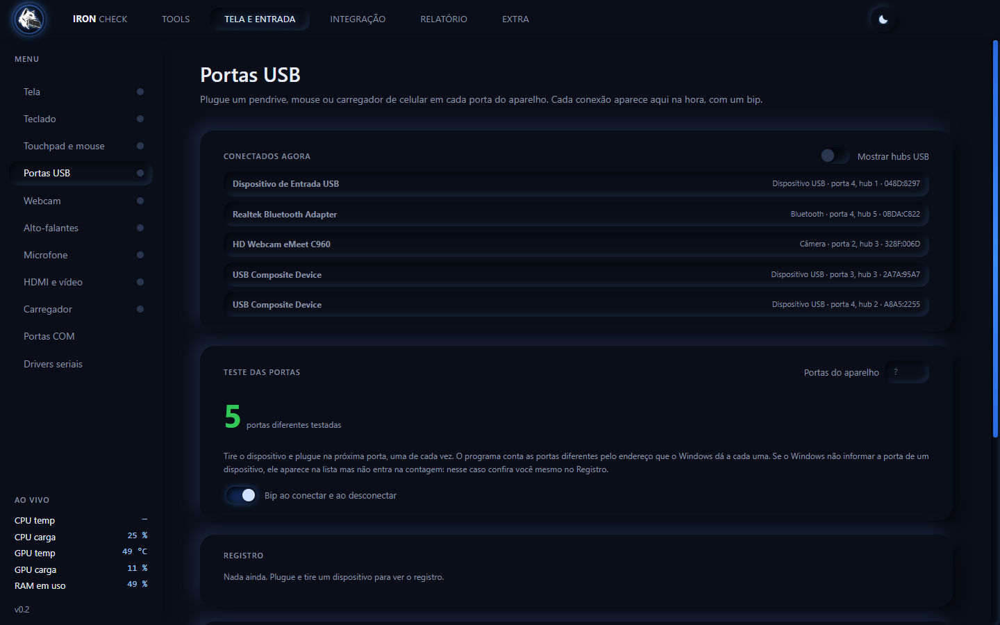
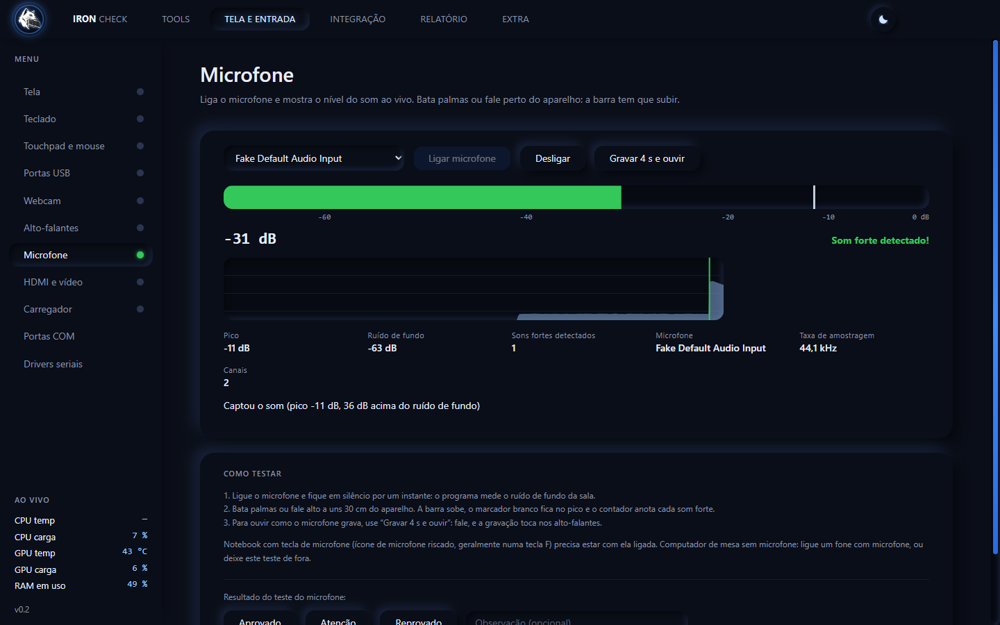
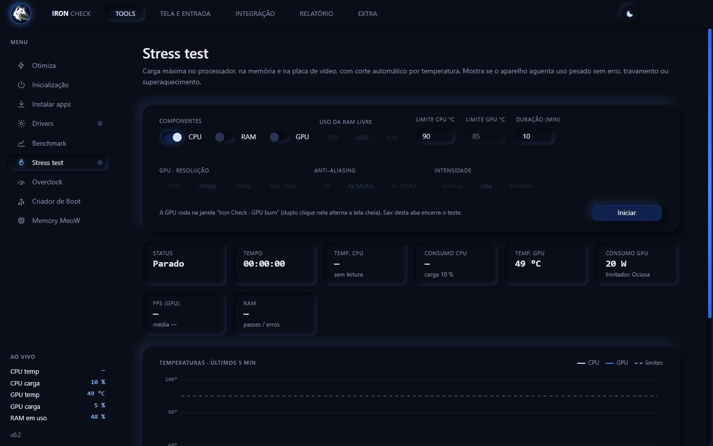

# IRON CHECK

### Entregue cada aparelho com laudo, não com promessa.

**Testes, diagnóstico, drivers e laudo em PDF para assistências técnicas. Tudo em português e em inglês (interruptor com as bandeiras do Brasil e dos EUA), num programa que roda do pendrive.**

[⬇️ Baixar o kit completo](https://github.com/MeoWDev-MOD/Iron-Check/releases/latest/download/Iron-Check-Kit.zip) ·
[💾 Só o programa](https://github.com/MeoWDev-MOD/Iron-Check/releases/latest/download/Iron-Check-Portatil.exe) ·
[🌐 Ver o site](https://meowdev-mod.github.io/Iron-Check/) ·
[💬 Pedir chave de teste](https://wa.me/5521966547296?text=Ol%C3%A1!%20Quero%20uma%20chave%20de%20teste%20do%20Iron%20Check.)

---

  

## 🐺 O que é

O **Iron Check** é um programa para Windows feito para **donos de assistência técnica e lojas de reparo**. Num lugar só, ele **testa o computador inteiro**, **instala o driver que falta (o da placa de rede, até sem internet)**, prepara a máquina, cria pendrive bootável e **emite um laudo em PDF com a ordem de serviço** para você entregar ao cliente e arquivar.

Aparelho que volta custa tempo, dinheiro e cliente. O Iron Check foi feito para você parar de entregar na base da promessa: **consertou? Agora prove.**

---

## 😩 Você se reconhece?

- **Cinco programas para um reparo.** Um para ler o hardware, outro para o HD, outro para a memória, um site para o teclado… quase tudo em inglês, e nada fica registrado.
- **"Foi você que estragou."** Sem prova do que foi testado e de como o aparelho saiu da sua bancada, vira a palavra de um contra a do outro.
- **Formatou e ficou sem rede.** Sem o driver da placa de rede não há internet para baixar o driver da placa de rede.
- **O defeito que só aparece depois.** HD com setores ruins, memória de vídeo falhando, bateria gasta, porta USB frouxa.

| Hoje | Com o Iron Check |
|---|---|
| Vários programas e sites de teste, quase tudo em inglês | **Um programa só**, em português e em inglês, que roda do pendrive |
| Teste no olho e anotação no papel ou no WhatsApp | Testes guiados, com o **resultado de cada um registrado** |
| O cliente reclama e você não tem como provar | **Laudo em PDF** com loja, OS, hardware e testes, com código único |
| Formatou e a rede ficou sem driver | Driver da rede no pendrive, **instala sem internet** (mais de 400 modelos de placa) |
| Descobre o HD ruim depois de entregar | **SMART, superfície e desempenho** antes de entregar |
| Entrega sem saber se aguenta uso pesado | **Stress test** com corte automático por temperatura |

---

## 🧰 O que o Iron Check faz

**1 · Receba e identifique**
- **Hardware completo, no estilo CPU-Z** — 13 categorias (equipamento, placa-mãe e BIOS, processador, memória, vídeo, discos, tela, rede, áudio, bateria, dispositivos, segurança e Windows).
- **Testes automáticos** — sistema, bateria, disco, memória, processador, Wi-Fi, Bluetooth e drivers em sequência.
- **Sensores ao vivo** — temperaturas, cargas, clocks, consumo e ventoinhas, com mínimo, máximo e alertas.
- **Ficha da placa de vídeo** e **saúde da bateria** (%, capacidade e ciclos).

**2 · Teste cada peça**
- **Discos (HD, SSD SATA e NVMe)** — SMART, varredura de superfície só de leitura, desempenho e integridade.
- **Memória RAM e processador** — erros contados, nota de vários núcleos e de um núcleo, queda por calor.
- **Memory MeoW** — testa a memória de vídeo em 12 padrões, mostra os bits com falha e aponta a causa provável.
- **Tela, teclado e touchpad** — pixels mortos, manchas, tecla por tecla, gesto por gesto.
- **Portas USB, webcam, alto-falantes, microfone, HDMI e carregador** — plugue e veja na hora; bata palmas e veja a barra do microfone subir.
- **Wi-Fi e Bluetooth.**

**3 · Conserte e deixe pronto**
- **Drivers, rede primeiro** — reconhece a placa de rede e instala o driver da biblioteca (Intel, Realtek, MediaTek, Qualcomm/Atheros e Broadcom), sem internet.
- **Driver de vídeo NVIDIA** — baixado só do servidor oficial, com a assinatura conferida e ponto de restauração antes.
- **Conversores USB-serial e portas COM** (CH340, CP210x, FTDI, Prolific), **instalar apps**, **inicialização**, **otimiza**.
- **Criador de Boot** — grava ISO em pendrive UEFI. **Overclock seguro** (NVIDIA), temporário e pela via oficial.

**4 · Prove que aguenta**
- **Stress test** — processador, memória e placa de vídeo juntos, com corte por temperatura e gráfico dos últimos 5 minutos.
- **Benchmark** — 7 testes, com nota para comparar antes e depois. **Diagnóstico de rede.**

**5 · Entregue com prova**
- **Laudo técnico em PDF** com loja, OS, cliente, hardware completo, resultado de cada teste e linhas de assinatura. Sai em português ou em inglês, conforme o idioma da tela.
- **Português e inglês** com um clique, pelo interruptor das bandeiras do Brasil e dos EUA no topo.
- **Código único** em cada laudo e **conferência de autenticidade** (SHA-256): o botão *Conferir* mostra se o PDF arquivado foi alterado.

---

## 📄 O laudo

   
  Exemplo de laudo gerado pelo programa. Os identificadores do aparelho foram ocultados.

---

## 📸 Por dentro

| | |
|:---:|:---:|
|  |  |
| **Testes automáticos** — cada teste com o seu veredito | **Sensores** — temperaturas, cargas e consumo ao vivo |
|  | |
| **Português e inglês** — troca com um clique, laudo incluído | |
|  |  |
| **Discos** — SMART, superfície, desempenho e integridade | **Teclado** — cada tecla acende ao ser apertada |
|  |  |
| **Portas USB** — plugue e veja na hora | **Microfone** — bata palmas e veja a barra subir |
|  |  |
| **Stress test** — CPU, RAM e GPU com corte por temperatura | **Benchmark** — 7 testes com nota |
|  |  |
| **Memory MeoW** — procura defeito na memória de vídeo | **Drivers** — rede primeiro, depois vídeo e o resto |
|  |  |
| **Relatório** — loja, OS e o botão do PDF | **Criador de Boot** — pendrive bootável de ISO do Windows ou Linux |

---

## ⬇️ Download

| Arquivo | Para quê |
|---|---|
| **[Iron-Check-Kit.zip](https://github.com/MeoWDev-MOD/Iron-Check/releases/latest/download/Iron-Check-Kit.zip)** (353 MB) | **Recomendado.** O programa + a pasta `drivers` (mais de 400 modelos de placa de rede e conversores USB-serial) + LEIA-ME. Extraia e leve a pasta inteira para o pendrive. |
| **[Iron-Check-Portatil.exe](https://github.com/MeoWDev-MOD/Iron-Check/releases/latest/download/Iron-Check-Portatil.exe)** (92 MB) | Só o programa, para experimentar. Abre sozinho, mas sem a biblioteca de drivers de rede. |

**Como usar**
1. Peça a sua chave (de teste ou de assinante) no WhatsApp.
2. Extraia o kit e abra o `Iron-Check-Portatil.exe`. Aceite o pedido de administrador do Windows.
3. A **primeira abertura prepara os arquivos** numa pasta `IronCheck-programa` ao lado do `.exe` (alguns segundos); as seguintes abrem rápido (cerca de 1 segundo no nosso teste).
4. Digite a chave. Os dados (chave e configurações) ficam numa pasta `IronCheck-dados` **ao lado do arquivo**, não no computador do cliente.
5. Mantenha a pasta **`drivers` ao lado do `.exe`**: é de lá que o programa instala o driver da placa de rede sem internet.

> O Windows pode mostrar o aviso de "editor desconhecido" (SmartScreen): clique em **Mais informações → Executar assim mesmo**. Alguns antivírus analisam o arquivo na primeira abertura, o que pode levar alguns segundos a mais.

---

## 🔑 Teste, assinatura e suporte

- **Quer testar?** Peça uma **chave de teste** pelo WhatsApp: ela vale por poucos dias e libera o programa completo.
- A **assinatura é mensal**. Pague pelo **Pix** e mande o comprovante no WhatsApp: você recebe a sua **chave**, que serve em **vários computadores** (feito para técnicos que atendem em muitos PCs). Para saber o valor, é só perguntar.
- A chave é conferida pela internet. Sem confirmação, o programa roda até 24 horas com a última conferência e depois fica bloqueado até regularizar. **Seus arquivos nunca são apagados.**
- **Computador sem rede?** A tela de ativação oferece a aba **Drivers** (só ela) para instalar o driver da placa de rede a partir da pasta `drivers`. Depois que a rede funciona, a chave é conferida sozinha.
- O uso da mesma chave por muitas pessoas é detectado, e a chave pode ser bloqueada.

  <a href="https://wa.me/5521966547296?text=Ol%C3%A1!%20Quero%20uma%20chave%20de%20teste%20do%20Iron%20Check."><b>📱 Falar no WhatsApp · 21 96654-7296</b></a>

---

## 🛡️ Seguro para o aparelho do cliente

- A **varredura de superfície só lê**; o teste de desempenho usa um arquivo temporário apagado no fim. Nenhum teste grava no disco bruto.
- O **Criador de Boot** só enxerga pendrives USB e nunca toca no disco do sistema.
- **Overclock temporário** (volta ao reiniciar) e só pelos controles oficiais da NVIDIA; os ajustes de jogo guardam o valor original; o driver de vídeo ganha **ponto de restauração** antes de instalar.
- Drivers só de **fontes oficiais**; o de vídeo é baixado de servidores da NVIDIA, com a assinatura digital conferida.

---

## 💻 Requisitos

- **Windows 10 ou 11** (64 bits) no computador onde você abre o arquivo. Não roda em Windows 7 ou 8.
- Para os testes completos (saúde dos discos, temperatura, overclock, criar pendrive): **abrir como administrador** (o programa já pede).
- Placa de vídeo **NVIDIA GeForce** para os recursos específicos de placa (overclock, instalação do driver); AMD e Intel funcionam no restante.
- **Internet** para conferir a chave (ao abrir e de tempos em tempos).

---

Developed By **MeoWDev MOD** · [@honorio.dev](https://www.instagram.com/honorio.dev/)

