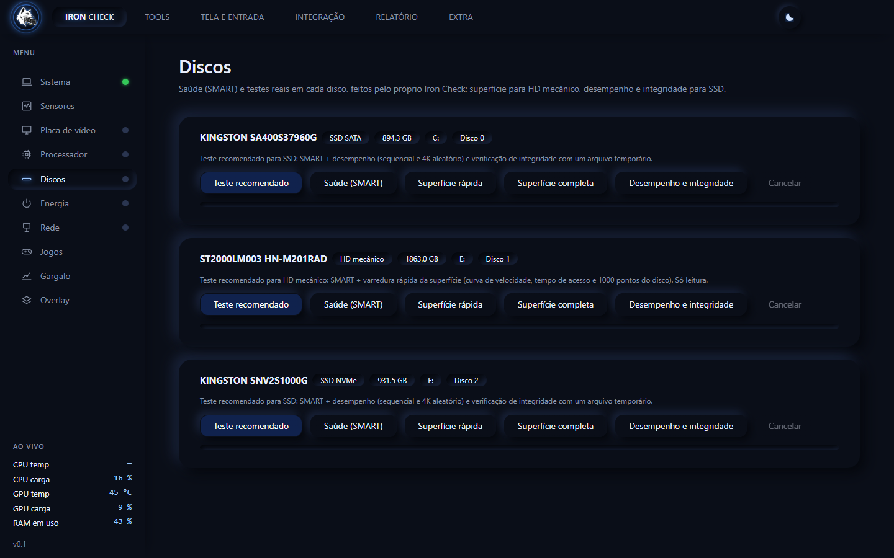
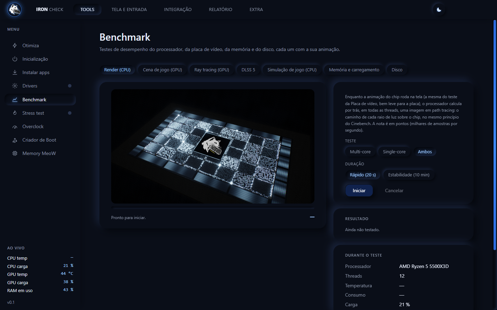
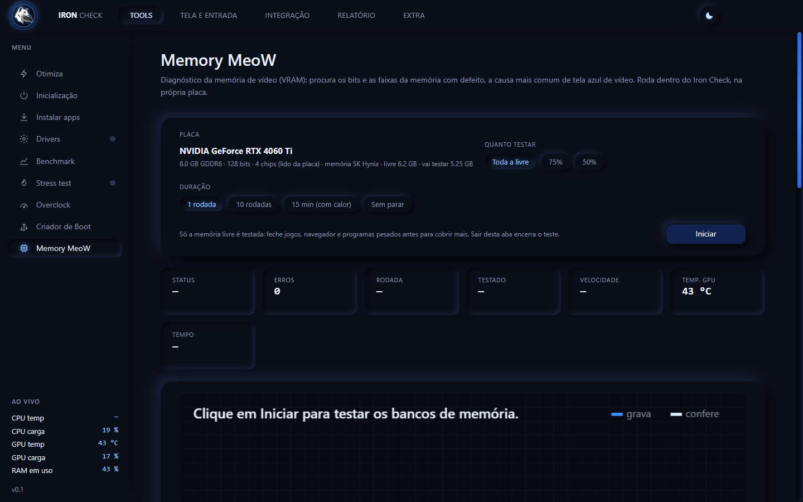
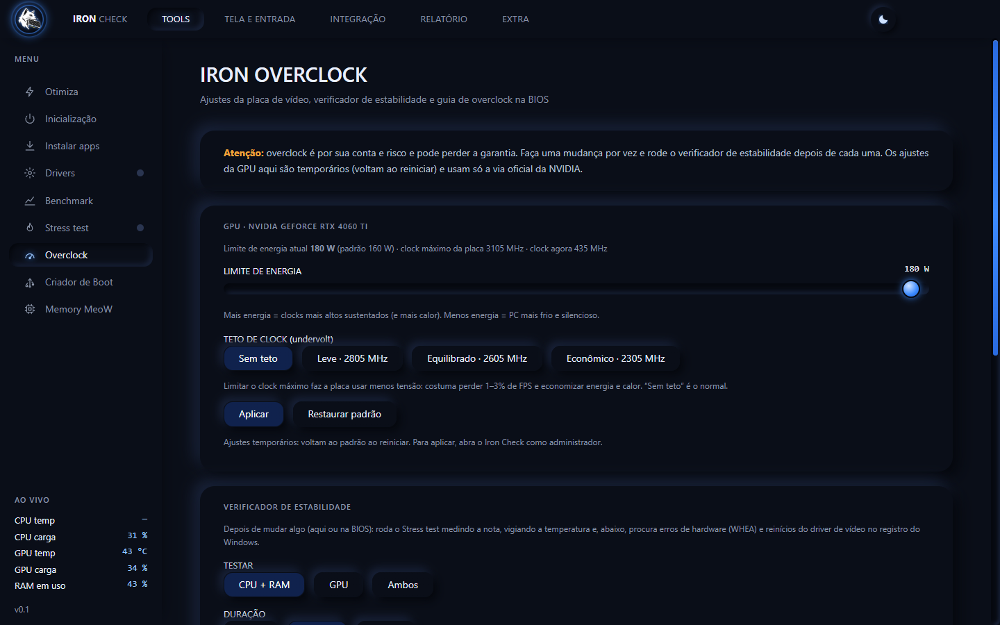
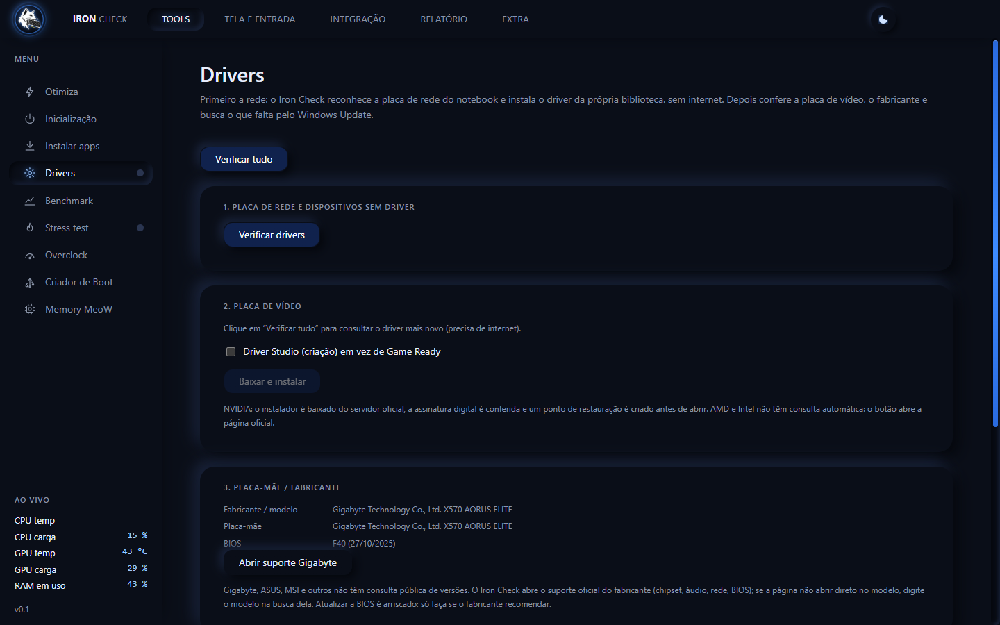
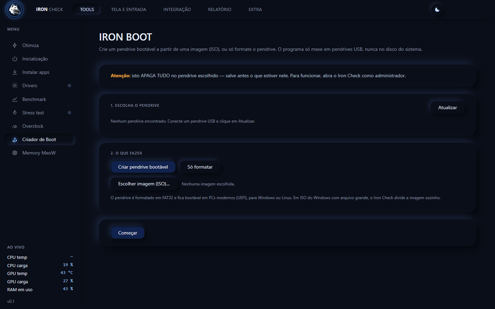
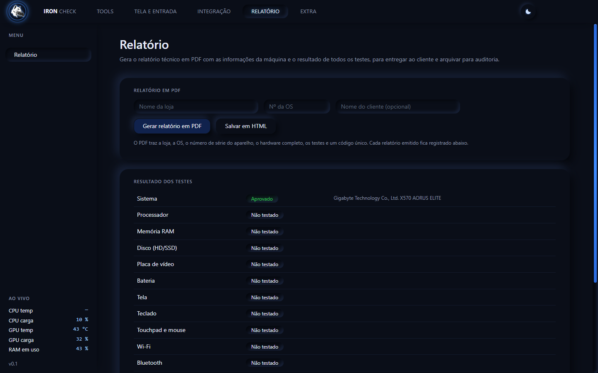

# IRON CHECK

### A bancada do técnico num programa só.

**Testes, diagnóstico, drivers, overclock seguro e laudo em PDF para notebooks e PCs. Tudo em português, num único arquivo que roda do pendrive.**

[⬇️ Baixar para Windows](https://github.com/MeoWDev-MOD/Iron-Check/releases/latest/download/Iron-Check-Portatil.exe) ·
[🌐 Ver o site](https://meowdev-mod.github.io/Iron-Check/) ·
[💬 Pedir chave de teste](https://wa.me/5521966547296?text=Ol%C3%A1!%20Quero%20uma%20chave%20de%20teste%20do%20Iron%20Check.)

---

  

## 🐺 O que é

O **Iron Check** é um programa para Windows feito para **assistências técnicas e lojas de reparo**. Em um lugar só, ele testa todas as peças do computador, instala drivers, otimiza a máquina, faz overclock seguro, cria pendrive bootável e **emite um relatório em PDF com a ordem de serviço** para você entregar ao cliente e arquivar.

Chega de abrir cinco programas diferentes para cada reparo. **Consertou? Agora prove** — com laudo e número de OS.

---

## 📸 Por dentro

| | |
|:---:|:---:|
|  |  |
| **Discos** — SMART, superfície, desempenho e integridade | **Benchmark** — CPU, GPU, ray tracing, memória e disco |
|  |  |
| **Memory MeoW** — procura defeito na memória de vídeo | **Overclock** — ajustes oficiais e verificador de estabilidade |
|  |  |
| **Drivers** — rede primeiro, depois vídeo e o resto | **Criador de Boot** — pendrive bootável de qualquer ISO |
|  | |
| **Relatório** — laudo em PDF com loja e OS | |

---

## 🧰 O que o Iron Check resolve

- **🔍 Detalha o computador inteiro** — processador, memória, placa de vídeo, discos, tela, bateria, rede, segurança e mais, no estilo CPU-Z.
- **💾 Testa todos os HDs e SSDs** — saúde (SMART), varredura de superfície (só leitura) e desempenho, com teste específico para HD, SSD SATA e NVMe.
- **🖥️ Testa a tela** — procura pixels mortos, manchas e vazamento de luz. Fundamental após troca de tela.
- **⌨️ Testa teclado e touchpad** — tecla por tecla e gesto por gesto. Fundamental após reparo.
- **🧠 Memory MeoW** — procura o defeito na memória da placa de vídeo, bit a bit, e aponta a causa provável.
- **🔥 Stress test** — CPU, RAM e placa juntos, com corte por temperatura. Garante que o aparelho aguenta antes de entregar.
- **📊 Benchmark** — nota de processador, placa, memória e disco, com ray tracing e checagem de DLSS.
- **📥 Instala os drivers que faltam** — biblioteca própria (o driver de rede funciona **até sem internet**), driver de vídeo pelo servidor oficial e o resto pelo Windows Update.
- **⚡ Overclock seguro** — ajusta a placa NVIDIA pela via oficial, com verificador de estabilidade e guia de BIOS.
- **🚀 Criador de Boot** — formata o pendrive e grava uma ISO (Windows, Linux ou qualquer sistema) deixando-o bootável. Só mexe em pendrives USB, nunca no disco do sistema.
- **✨ Otimiza a máquina** — limpa a memória, fecha o que atrapalha e ajusta o Windows para jogos.
- **🌐 Diagnóstico de rede** — diz se o lag vem do Wi-Fi, do provedor ou de excesso de fila na conexão.
- **📄 Relatório em PDF** — com a **identificação da loja e o número da OS**, para entregar ao cliente e usar em auditoria. Cada laudo tem um código único e dá para conferir depois se foi alterado.

---

## ⬇️ Download

**[Baixar o Iron Check para Windows](https://github.com/MeoWDev-MOD/Iron-Check/releases/latest/download/Iron-Check-Portatil.exe)** — um arquivo só (`Iron-Check-Portatil.exe`), **sem instalar**: abra do pendrive, de qualquer pasta, em qualquer computador.

- A **primeira abertura demora** (o programa se descompacta; pode levar de 15 segundos a alguns minutos). Clique uma vez só e aguarde.
- O programa pede **administrador** para ler a saúde dos discos, a temperatura e instalar drivers.
- Os dados (chave e configurações) ficam numa pasta **`IronCheck-dados` ao lado do arquivo**, não no computador do cliente.
- O Windows pode mostrar um aviso de "editor desconhecido": clique em **Mais informações → Executar assim mesmo**.

---

## 🔑 Teste, assinatura e suporte

- **Quer testar?** Peça uma **chave de teste** pelo WhatsApp: ela vale por poucos dias e libera o programa completo.
- A **assinatura é mensal**. Pague pelo **Pix** e mande o comprovante no WhatsApp: você recebe a sua **chave**, que serve em **vários computadores** (feito para técnicos que atendem em muitos PCs). É só digitar a chave em cada um.
- A chave é conferida pela internet. **Computador sem rede?** A própria tela de ativação oferece a aba **Drivers** (só ela) para instalar o driver da placa de rede, que vem junto no programa. Depois que a rede funciona, a chave é conferida sozinha.
- O uso da mesma chave por muitas pessoas é detectado, e a chave pode ser bloqueada. Sem confirmação, o programa fica bloqueado até a licença ser regularizada. **Seus arquivos nunca são apagados.**

  <a href="https://wa.me/5521966547296?text=Ol%C3%A1!%20Quero%20uma%20chave%20de%20teste%20do%20Iron%20Check."><b>📱 Falar no WhatsApp · 21 96654-7296</b></a>

---

## 💻 Requisitos

- **Windows 10 ou 11** (64 bits).
- Para os testes completos (saúde dos discos, temperatura, overclock, criar pendrive): **abrir como administrador**.
- Placa de vídeo **NVIDIA GeForce** para os recursos específicos de placa (AMD e Intel funcionam no restante).
- **Internet** para conferir a chave (ao abrir e de tempos em tempos; o programa aguenta algumas horas sem conexão).

---

Developed By **MeoWDev MOD** · [@honorio.dev](https://www.instagram.com/honorio.dev/)

